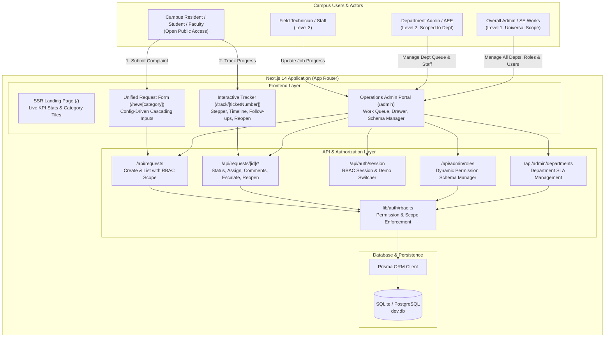
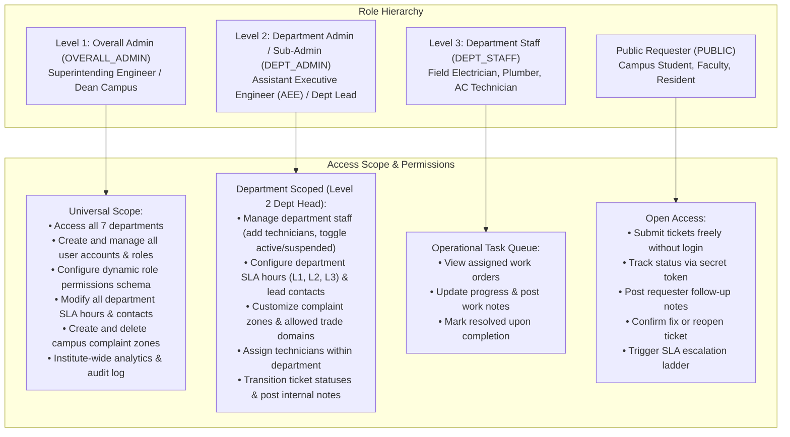
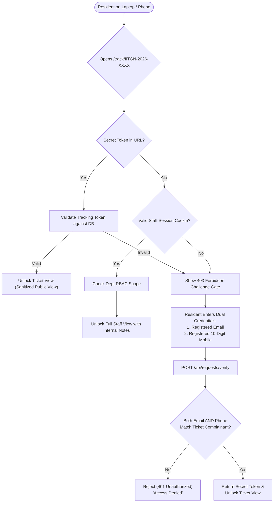
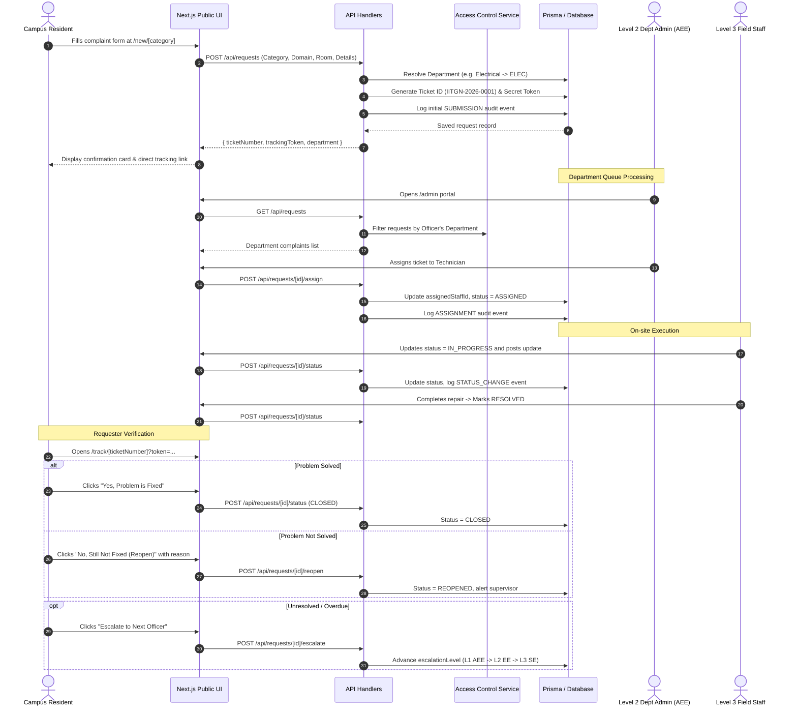
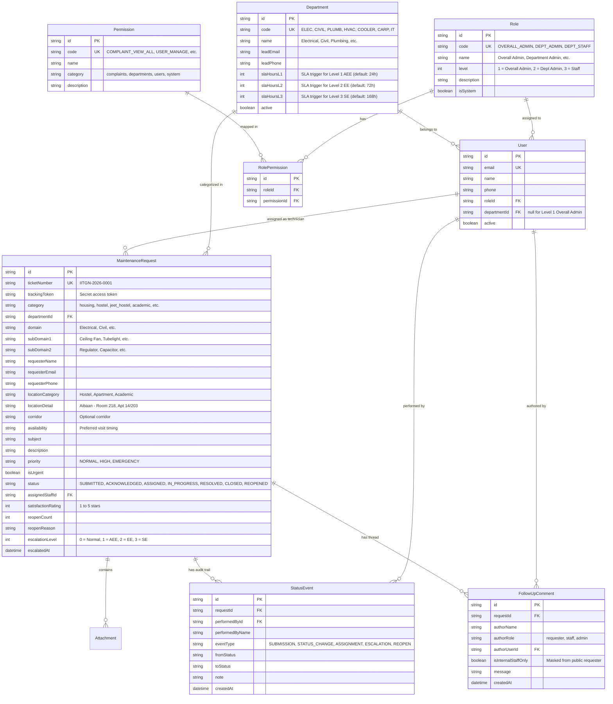
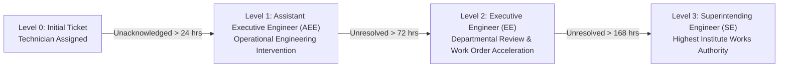
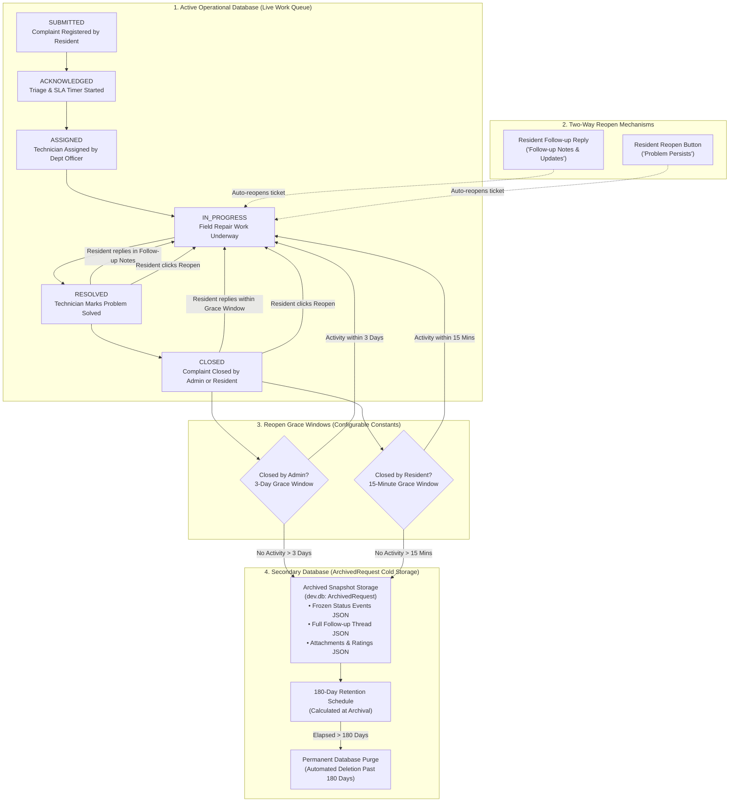

CampusDigitalInfra

> **Institute Works Department (IWD)**  
> **Indian Institute of Technology Gandhinagar (IITGN)**  
> Built with **Next.js 14 (App Router) • TypeScript • Tailwind CSS • Prisma ORM • SQLite / PostgreSQL**

---

## 1. Executive Summary & Purpose

The **IITGN Maintenance Request System (MRS)** is the official facility engineering and campus maintenance platform for the Indian Institute of Technology Gandhinagar. It provides:

1. **Open Access Complaint Registration:** Students, faculty, staff, and campus residents can report civil, electrical, plumbing, HVAC, and carpentry issues instantly without login friction or barriers.
2. **Two-Way Status Tracking & Verification:** Every complaint receives a human-friendly ticket number (`IITGN-2026-XXXX`) and an access token to check progress, follow up with technicians, confirm resolution, or reopen tickets.
3. **Operations & Department Command Portal:** A role-based administration portal featuring **2 levels of administrative access** (Overall Super Admin and Department Admin), field technician task queues, and dynamic permission schema configuration.
4. **Config-Driven & Modular Architecture:** Categories, domains, apartment lists, escalation contacts, and role capabilities are managed via configuration and database tables rather than hard-coded logic.

---

## 2. System Architecture & Topology

The system uses a modern Next.js 14 full-stack architecture combining Server-Side Rendering (SSR) for fast loading with client-side reactivity and secure route handlers:



---

## 3. Role-Based Access Control (RBAC) & 2-Level Admin Model

The application enforces strict **Role-Based Access Control (RBAC)** designed around campus engineering hierarchy:



### Access Comparison Matrix

| Capability | Public Requester | Level 3: Field Staff | Level 2: Dept Admin (Sub-Admin) | Level 1: Overall Admin |
|---|:---:|:---:|:---:|:---:|
| **File Complaints** | ✔ (Open Access) | ✔ | ✔ | ✔ |
| **Track Own Ticket** | ✔ (Via Secret Token) | ✔ | ✔ | ✔ |
| **View Department Work Queue** | ✖ | ✔ (Assigned Only) | ✔ (Own Department Only) | ✔ (All Departments) |
| **Assign / Reassign Technicians**| ✖ | ✖ | ✔ (Within Own Department) | ✔ (Universal) |
| **Update Complaint Status** | ✖ | ✔ (Assigned Jobs) | ✔ (Own Department) | ✔ (Universal) |
| **Post Internal Staff Notes** | ✖ | ✔ | ✔ | ✔ |
| **Department Filter Override** | ✖ | ✖ | ✖ (Security Locked) | ✔ (Switchable) |
| **Manage Department Staff & Techs** | ✖ | ✖ | ✔ (Add/Toggle Own Dept Staff) | ✔ (Universal) |
| **Configure Complaint Zones & Domains** | ✖ | ✖ | ✔ (Edit Allowed Domains/Toggles) | ✔ (Full CRUD + Delete) |
| **Configure Department SLAs & Contacts** | ✖ | ✖ | ✔ (Own Department SLAs & Contacts) | ✔ (All Departments) |
| **Edit Role Permissions Schema**| ✖ | ✖ | ✖ | ✔ (Universal) |

### 3.2 "Mind Your Own Business" Privacy Architecture & Zero-Snoop Protocol

Public maintenance systems often introduce accidental data leaks when adopting friendly, sequential ticket numbers (e.g. `IITGN-2026-0001`, `0002`). Without defensive gating, curious peers could enumerate numbers to spy on residents' room numbers, mobile contacts, repair descriptions, or personal schedules.

To enforce strict **"Mind Your Own Business"** confidentiality across campus devices:



#### Why Alternative Approaches Were Rejected:
1. **Why IP-based Access Fails:**
   - **Cross-device usage:** A resident files a broken AC ticket on their mobile phone over cellular data (5G/4G) and later checks its status on their laptop over hostel Wi-Fi. IP gating would lock them out of their own complaint.
   - **Campus NAT/Proxy collision:** Hundreds of students and faculty share the same institutional gateway/proxy IP address, giving zero security separation.
2. **Why Email-Only Lookups Fail:**
   - Institutional emails (`rollnumber@iitgn.ac.in` or `firstname.lastname@iitgn.ac.in`) are predictable and searchable in institute directories. Anyone knowing a resident's roll number could spy on their maintenance complaints.

#### The Implemented Solution:
- **Zero Public Aggregate Metrics:** The public landing page exposes NO aggregate statistics (`Total Registered`, `In Progress`, `Resolved`, department breakdowns).
- **Direct Magic Token:** When submitting a complaint, the resident receives a unique cryptographic tracking token embedded in their confirmation link (`/track/IITGN-2026-XXXX?token=...`).
- **Cross-Device Privacy Challenge Gate:** If visited without the token (e.g., typing the ticket number on a new laptop), the system locks down with HTTP `403 Forbidden` and presents a secure challenge requiring **Registered Email + 10-Digit Mobile Number**.
- **Internal Staff Note Masking:** Even when a ticket is unlocked, internal engineering notes (`isInternalStaffOnly = true`) are stripped unless the visitor is an authenticated staff member with assigned department privileges.

---

## 4. End-to-End Complaint Lifecycle & Sequence



---

## 5. Database Schema (Prisma ERD)

The database schema is structured for modularity and extensible access control:



---

## 6. Dynamic Role & Permissions Customization

The system is designed so that administrators can **change permissions dynamically** without modifying application code:

1. **Schema Separation:** Roles and granular permissions are stored as records in the database (`Role`, `Permission`, `RolePermission`).
2. **Admin UI Manager:** Overall Admins can navigate to **`/admin` → "Role & Permission Schema"** tab to view the live permissions matrix and toggle capabilities on or off for any role tier.
3. **Instant API Persistence:** Changes are posted to `PATCH /api/admin/roles`, updating database mappings in real-time.
4. **Code Fallbacks:** System defaults in [`src/config/roles.ts`](file:///Users/aai/Desktop/iitgn-maintenance-docs/src/config/roles.ts) serve as baseline blueprints for seeding and migrations.

---

## 7. Department Routing & Cascading Options

The application replaces legacy copy-pasted HTML pages with a single data-driven structure in [`src/config/categories.ts`](file:///Users/aai/Desktop/iitgn-maintenance-docs/src/config/categories.ts):

| Department Code | Department Name | Allowed Categories | Cascading Fault Tree Examples |
|---|---|---|---|
| **`ELEC`** | Electrical Maintenance | Housing, Hostels, JEET, Academic, Infrastructure | Ceiling Fan (Regulator, Noise), Power Socket (Sparking, Burned), Main MCB Panel |
| **`CIVIL`** | Civil & Masonry | Housing, Hostels, JEET, Academic, Infrastructure | Seepage & Dampness, Wall Paint / Plaster, Broken Tiles, Window Panes |
| **`PLUMB`** | Plumbing & Sanitary | Housing, Hostels, JEET, Academic, Infrastructure | Taps & Faucets, Drainage & Waste Pipe, Toilet Flush Tank, Pipeline Burst |
| **`HVAC`** | Air-Conditioning (AC) | Academic, JEET, Hostels, Infrastructure | Split AC Unit (No cooling, water dripping), Remote Controller, Gas Servicing |
| **`COOLER`**| Water-Coolers & R.O. | Hostels, Academic, Infrastructure | Drinking Water Cooler (Warm water, tap leak), R.O. Filter Cartridge |
| **`CARP`** | Carpentry & Furniture | Housing, Hostels, Infrastructure | Door Locks & Latches, Cupboard Hinges, Study Table & Chair Repair |
| **`IT`** | Network & Telecom | Academic, Infrastructure | Ethernet Wall Port, Wi-Fi AP Cabling, Intercom Line Fault |

---

## 8. Dynamic Complaint Zones & In-Place Visual Form Editor

Designed for non-technical administrators (e.g. Institute Works Executive Officers and Department Leads), the portal features both high-level zone management in `/admin` and an **In-Place Live Visual Form Editor** accessible at `/new/[slug]?mode=editor`:

```mermaid
flowchart TD
    subgraph AdminPortal["1. Admin Portal (/admin)"]
        ZoneCards["Zone Management Cards<br/>(Faculty Housing, Hostels, Academic Labs, etc.)"]
        QuickEdit["Quick Modal Edit<br/>(Name, Slug, Icon, Active Status)"]
        OpenEditorBtn["'Visual Form Editor' Button<br/>(Opens /new/[slug]?mode=editor)"]
    end

    subgraph VisualEditor["2. In-Place Live Visual Form Editor (/new/[slug]?mode=editor)"]
        TopBar["Floating Top Admin Toolbar<br/>• Save All Changes (Instant DB Sync)<br/>• Preview Public View vs Edit Mode Toggle<br/>• Restore Campus Defaults"]
        HeaderEditor["Header & SLA Customizer<br/>• In-place Title & Subtitle editing<br/>• Response SLA Badge text ('Avg Response: < 24 hrs')<br/>• Seasonal / Emergency Announcement Banner"]
        BuildingManager["🏢 Buildings & Locations Manager<br/>• Academic: Add/remove complexes (e.g. 'Academic Complex 5 (AB 5)', 'Design Studio')<br/>• Hostels: Add/remove blocks (e.g. 'Hostel 13 - Nilgiri', 'Block E')<br/>• Housing: Add/edit apartments & toggle corridor wing requirement<br/>• General: Add campus facilities & landmarks"]
        TradeManager["⚡ Trades & Domains Customizer<br/>• Click ✕ to remove trades, + to add trades (Electrical, Civil, AC, Plumbing, etc.)"]
        CascadeManager["🔧 Custom Fault Hierarchy Builder<br/>• Add new fault categories (SubDomain 1) & symptoms (SubDomain 2)"]
    end

    subgraph LiveResidents["3. Live Public Complaint Form (/new/[slug])"]
        UpdatedDropdown["Dropdown auto-loads newly added buildings & complexes"]
        ActiveNotice["Renders announcement banner if configured"]
        CustomTrades["Offers tailored trade selection & cascading options"]
    end

    ZoneCards --> OpenEditorBtn
    ZoneCards --> QuickEdit
    OpenEditorBtn --> VisualEditor
    TopBar -->|Persists via PUT /api/categories/[id]| DB[("ComplaintCategory (dev.db)")]
    DB --> LiveResidents
```

### Key Capabilities of the In-Place Form Editor:
1. **Granular Building & Location Customization:**
   - **Academic Complex & Labs:** Easily append new research wings or lecture blocks (e.g., `Academic Complex 5 (AB 5)`, `Biomedical Engineering Wing`, `Central Workshop`).
   - **Student Hostels:** Add newly constructed hostel wings (e.g., `Hostel 13 - Nilgiri`, `Block E (JEET Extension)`).
   - **Faculty Housing:** Add custom apartment blocks and toggle corridor/wing requirements.
   - **Campus Infrastructure:** Register specific facilities (e.g., `Olympic Swimming Pool`, `Squash Court 1`, `Substation 3`).
2. **Instant Preview & Public View Toggle:** Administrators can test the exact filing experience with a single click on *"Preview Public View"*, then toggle back to *"Switch to Editor Mode"* without leaving the page.
3. **Custom Fault Hierarchy & Cascades:** Add domain-specific problem categories and symptom checklists (e.g., adding `Smart Classroom / AV` under Electrical with symptoms `["HDMI No Signal", "Projector Blinking"]`).
4. **Emergency / Maintenance Banners:** Display real-time notices on the complaint form (e.g., notifying residents of scheduled water shutdown or lift servicing).
5. **Zero Downtime Persistence:** All customizations are saved directly to the database via `PUT /api/categories/[id]` and immediately reflected across the entire campus.

---

## 9. Complaint Redressal & 3-Tier Escalation Ladder

Complaints that exceed Service Level Agreement (SLA) hours or involve safety hazards follow a standardized 3-level redressal ladder:



- **Emergency Hazards:** Selecting the *"Flag as Urgent / Safety Hazard"* checkbox immediately flags the ticket for 24x7 Works Control Room inspection and initiates auto-escalation.
- **Manual Escalation:** Requesters can trigger the next escalation level directly from their tracking screen if the issue is unresolved beyond SLA hours.
- **Escalation Contacts:** Tailored per engineering trade and backed by environment variables (`ESCALATION_L1_CIVIL_EMAIL`, `ESCALATION_L1_ELECTRICAL_EMAIL`, etc.).

---

## 10. API Reference

### Public Endpoints
| Route | Method | Description |
|---|:---:|---|
| `/api/categories` | `GET` | Returns all active complaint zones/categories from database |
| `/api/categories/[id]` | `GET` | Returns single category details by slug or ID |
| `/api/options` | `GET` | Returns categories, departments, locations, and cascading domain trees |
| `/api/requests` | `POST` | Open complaint filing (returns `ticketNumber` and `trackingToken`) |
| `/api/requests` | `GET` | List requests by requester email + phone dual verification |
| `/api/requests/[id]` | `GET` | Single ticket lookup (requires `?token=...` query parameter for public users) |
| `/api/requests/[id]/comments` | `POST` | Post a follow-up message to the complaint thread |
| `/api/requests/[id]/reopen` | `POST` | Reopen a resolved complaint with an explanation |
| `/api/requests/[id]/escalate` | `POST` | Escalate a delayed ticket to the next engineering tier |

### Admin & Staff Endpoints
| Route | Method | Access Level | Description |
|---|:---:|:---:|---|
| `/api/categories` | `POST` | Level 1, 2 | Create a new complaint zone or portal |
| `/api/categories/[id]` | `PUT` | Level 1, 2 | Update title, icon, location style, or allowed trades |
| `/api/categories/[id]` | `DELETE` | Level 1 | Delete zone or safely deactivate if tickets exist |
| `/api/requests` | `GET` | Level 1, 2, 3 | List requests filtered automatically by the user's role and department |
| `/api/requests/[id]/status` | `POST` | Level 1, 2, 3 | Transition complaint status (`ACKNOWLEDGED`, `IN_PROGRESS`, `RESOLVED`, `CLOSED`) |
| `/api/requests/[id]/assign` | `POST` | Level 1, 2 | Assign or reassign a field technician to the work order |
| `/api/auth/session` | `GET` | Public | Returns current authenticated profile and available demo switch accounts |
| `/api/auth/session` | `POST` | Public | Switches active session profile (for demonstration/evaluation) |
| `/api/admin/roles` | `GET` | Level 1 | List roles, levels, user counts, and complete permission registry |
| `/api/admin/roles` | `PATCH` | Level 1 | Dynamically grant or revoke permissions for a role |
| `/api/admin/departments` | `GET` | Level 1, 2 | List departments with active work order counts and SLA hours |
| `/api/admin/departments` | `PATCH` | Level 1, 2 | Update department SLA trigger hours (L1, L2, L3) and lead contacts (Level 2 scoped to own dept) |
| `/api/admin/users` | `GET` | Level 1, 2 | List staff and administrators with active ticket load |
| `/api/admin/users` | `POST` | Level 1, 2 | Create staff account (Level 2 scoped to own department field staff) |
| `/api/admin/users` | `PATCH` | Level 1, 2 | Toggle staff active/suspended status and phone contact |

---

## 10. Directory Structure

```
/Users/aai/Desktop/iitgn-maintenance-docs/
├── prisma/
│   ├── schema.prisma              # Database schema (RBAC, Departments, Tickets, Audit)
│   └── seed.ts                    # Seeder populating roles, permissions, departments, demo accounts
├── src/
│   ├── app/
│   │   ├── (public)/
│   │   │   ├── new/[category]/    # Config-driven complaint form (Housing, Hostel, JEET, etc.)
│   │   │   ├── track/             # Public ticket & email search page
│   │   │   └── track/[ticketNumber]/ # Real-time ticket tracking, timeline, follow-ups
│   │   ├── admin/
│   │   │   └── page.tsx           # Operations & Admin Command Portal (Vertical banner layout)
│   │   ├── api/                   # Route handlers for requests, roles, depts, users, session
│   │   ├── globals.css            # Modern institutional styling & custom scrollbars
│   │   ├── layout.tsx             # Root layout with emergency hotline ticker & navbar
│   │   └── page.tsx               # SSR landing page with category cards & redressal ladder
│   ├── components/
│   │   └── Navbar.tsx             # Responsive navigation header
│   ├── config/
│   │   ├── categories.ts          # Category definitions, locations & domain cascading trees
│   │   ├── escalation.ts          # Escalation contacts & SLA trigger hours
│   │   ├── messages.ts            # UI text constants & validation messages
│   │   └── roles.ts               # Role codes, levels, permission codes & department defaults
│   └── lib/
│       ├── auth/
│       │   ├── rbac.ts            # RBAC authorization engine & department filtering
│       │   └── session.ts         # Session cookie resolver & demo user switcher
│       └── prisma.ts              # Prisma client singleton instance
├── .env                           # Local environment configuration
├── .env.example                   # Full reference of environment variables
└── README.md                      # Master system documentation (this file)
```

---

## 11. Quick Start & Local Setup

### Prerequisites
- **Node.js:** v18.17+ or v20+
- **npm:** v9+

### 1. Installation & Environment
```bash
# Install dependencies
npm install

# Verify .env has SQLite database url
echo 'DATABASE_URL="file:./dev.db"' >> .env
```

### 2. Database Sync & Seeding
```bash
# Push schema to SQLite database (dev.db)
npx prisma db push

# Seed default roles, departments, demo users, and sample tickets
npx tsx prisma/seed.ts
```

### 3. Run Development Server
```bash
npm run dev
```
The application will be live at **`http://localhost:3000`**.

### 4. Build for Production
```bash
npm run build
npm start
```

---

## 12. Pre-Seeded Demo Accounts for Evaluation

You can test all levels of Role-Based Access Control directly in the Admin Portal using the top **Switch Admin / Staff Profile** button bar:

| Role Level | Account Name | Email | Access Scope |
|---|---|---|---|
| **Level 1: Overall Admin** | Er. A. K. Jain (Superintending Engineer) | `admin@iitgn.ac.in` | **Universal Institute Access:** All 7 departments, Role Schema Manager, Users Directory, System SLAs. |
| **Level 2: Department Admin** | Er. Alok Verma (AEE Electrical) | `aee.electrical@iitgn.ac.in` | **Electrical Department Scoped:** Manages electrical work orders, assigns electricians, reviews tickets. |
| **Level 2: Department Admin** | Er. Priya Patel (AEE Civil) | `aee.civil@iitgn.ac.in` | **Civil & Plumbing Scoped:** Manages civil repairs, wall seepage, plumbing requests. |
| **Level 3: Field Staff** | Rajesh Kumar (Sr. Electrician) | `tech.rajesh@iitgn.ac.in` | **Field Work Queue:** Operational technician queue for electrical jobs. |
| **Level 3: Field Staff** | Suresh Patel (Lead Plumber) | `tech.suresh@iitgn.ac.in` | **Field Work Queue:** Operational technician queue for plumbing jobs. |

---

## 13. Complaint Lifecycle, Auto-Reopen Rules & Secondary Storage Archival (Cold Database)

To maintain high data integrity, operational speed, and campus resident satisfaction, the IITGN Maintenance Request System features an automated multi-tier complaint lifecycle:



---

### Key Lifecycle Rules & Behaviors

#### 1. Automatic Reopen on Resident Reply
When a resident submits a reply in **"Follow-up Notes & Updates"** on their tracking page (`/track/[ticketNumber]`):
- If the ticket is currently **`RESOLVED`** or **`CLOSED`** (and within its grace window), the system **automatically shifts the ticket back to `IN_PROGRESS`**.
- It is immediately removed from the `Resolved` and `Closed` queues in the Admin Portal and placed back into active operational focus.
- The `reopenCount` is incremented, and an official audit status event is recorded in the timeline.

#### 2. Reopen Grace Windows (Configurable Constants)
Developers and system administrators can customize all lifecycle durations in [`src/config/lifecycle.ts`](file:///Users/aai/Desktop/iitgn-maintenance-docs/src/config/lifecycle.ts) or via environment variables:

| Lifecycle Phase | Config Constant | Default Value | Environment Variable Override | Purpose |
|---|---|---|---|---|
| **Admin Closed Reopen Grace** | `ADMIN_CLOSED_REOPEN_GRACE_DAYS` | **3 Days** (72 hours) | `NEXT_PUBLIC_ADMIN_REOPEN_GRACE_DAYS` | Window granted to resident after department staff closes a ticket to verify repair or reopen. |
| **Resident Closed Archive Delay** | `USER_CLOSED_ARCHIVE_DELAY_MINUTES` | **15 Minutes** | `NEXT_PUBLIC_USER_ARCHIVE_DELAY_MINUTES` | Quick window if resident accidentally clicks "Problem is Fixed (Close Ticket)". |
| **Secondary DB Retention** | `ARCHIVE_PURGE_RETENTION_DAYS` | **180 Days** (~6 months) | `NEXT_PUBLIC_ARCHIVE_RETENTION_DAYS` | Period records are retained in cold storage before permanent database deletion. |

```typescript
// src/config/lifecycle.ts
export const LIFECYCLE_CONFIG = {
  // Reopen grace period if closed by Admin/Staff (in days)
  ADMIN_CLOSED_REOPEN_GRACE_DAYS: Number(
    process.env.NEXT_PUBLIC_ADMIN_REOPEN_GRACE_DAYS || 3
  ),

  // Archive delay if closed by requester (in minutes)
  USER_CLOSED_ARCHIVE_DELAY_MINUTES: Number(
    process.env.NEXT_PUBLIC_USER_ARCHIVE_DELAY_MINUTES || 15
  ),

  // Secondary database retention schedule before permanent deletion (in days)
  ARCHIVE_PURGE_RETENTION_DAYS: Number(
    process.env.NEXT_PUBLIC_ARCHIVE_RETENTION_DAYS || 180
  ),
};
```

#### 3. Transfer to Secondary Archival Database (`ArchivedRequest`)
- When a ticket exceeds its grace window without activity, it is cleanly transferred to the **`ArchivedRequest`** table in SQLite/PostgreSQL.
- All relationships (`StatusEvents`, `FollowUpComments`, `Attachments`) are serialized into frozen JSON snapshots (`statusEventsJson`, `followUpsJson`, `attachmentsJson`).
- The ticket is deleted from active operational tables (`MaintenanceRequest`), preventing queue bloat and ensuring sub-millisecond query performance for active campus complaints.
- If a resident visits `/track/[ticketNumber]` for an archived complaint, the system safely falls back to the secondary database, displays an informational notice, and informs them of the 180-day retention schedule while disabling further replies.

#### 4. Permanent Automated Deletion (180 Days)
- Each archived record has a computed `purgeDueAt` timestamp (`archivedAt + 180 days`).
- Background sweeps (triggered during active queue operations or manually via `POST /api/admin/lifecycle`) automatically and irreversibly purge records where `purgeDueAt <= Date.now()`.
- Overall Super Admins (Level 1) can view all secondary storage snapshots, inspect frozen threads, and trigger on-demand sweeps via the **Archived (Secondary DB)** tab in `/admin`.

---

### Two-Way Communication in Admin Portal & Tracker

```
┌────────────────────────────────────────────────────────┐
│ Resident Tracker (/track/[ticketNumber])               │
├────────────────────────────────────────────────────────┤
│ • Posts follow-up update                               │
│ • If RESOLVED or CLOSED -> automatically moves to      │
│   IN PROGRESS                                          │
│ • Sees public staff replies; internal notes hidden    │
└───────────────────────────┬────────────────────────────┘
                            │
                      API Synchronized
                            │
┌───────────────────────────▼────────────────────────────┐
│ Admin Portal (/admin) -> Manage Request Drawer         │
├────────────────────────────────────────────────────────┤
│ • Full communication thread with requester             │
│ • Toggle: [💬 Public Reply to Resident]                │
│       vs: [🔒 Internal Staff Note (Hidden)]            │
│ • Shows 3-day / 15-minute countdown alert if closed    │
│ • One-click "Reopen (In Progress)" button              │
└────────────────────────────────────────────────────────┘
```

